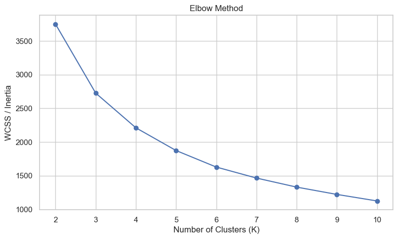
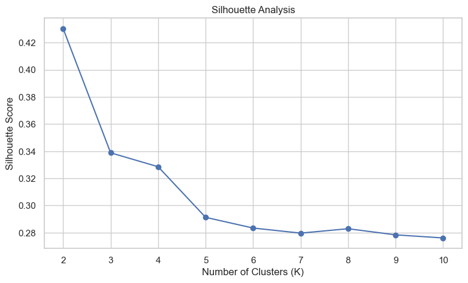
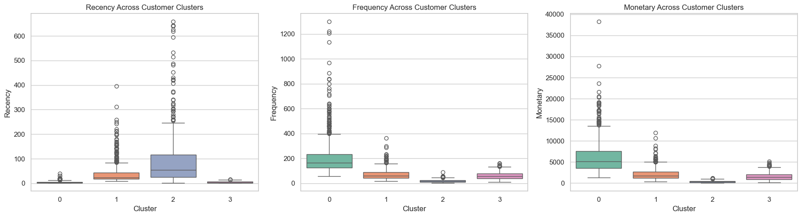
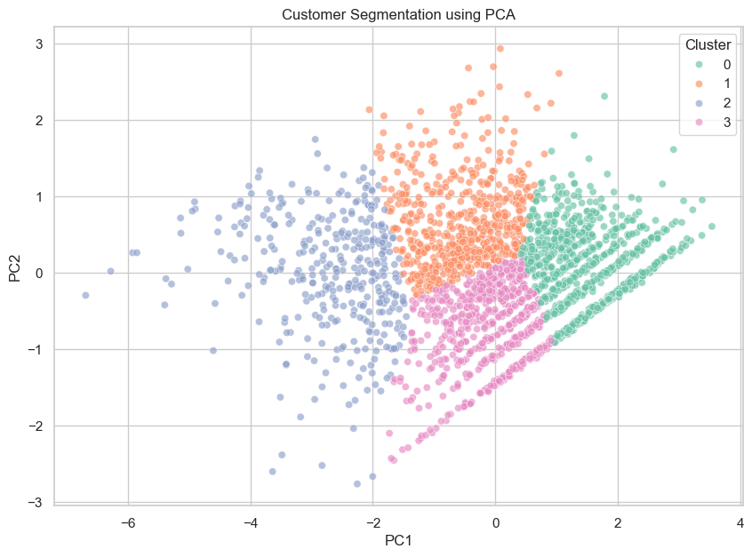
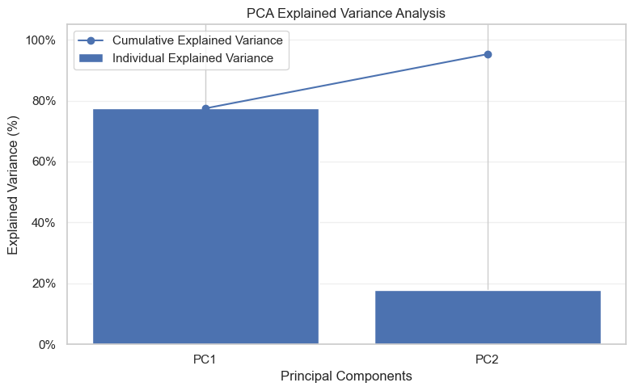
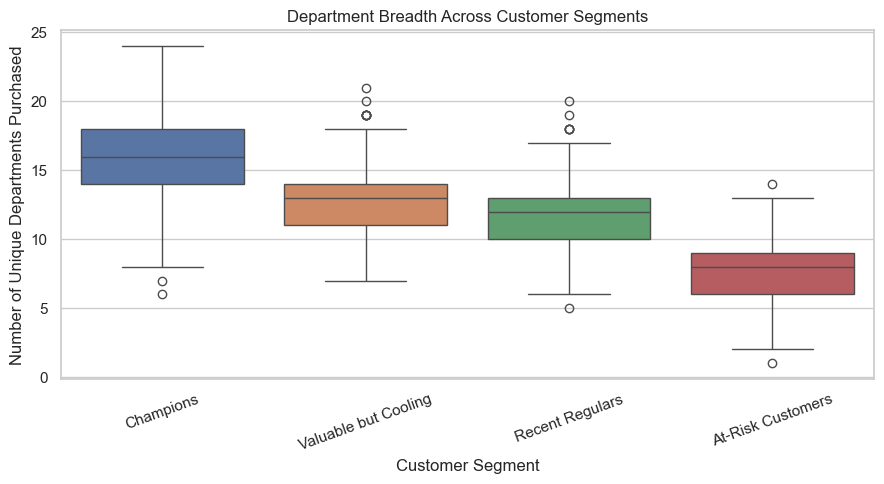
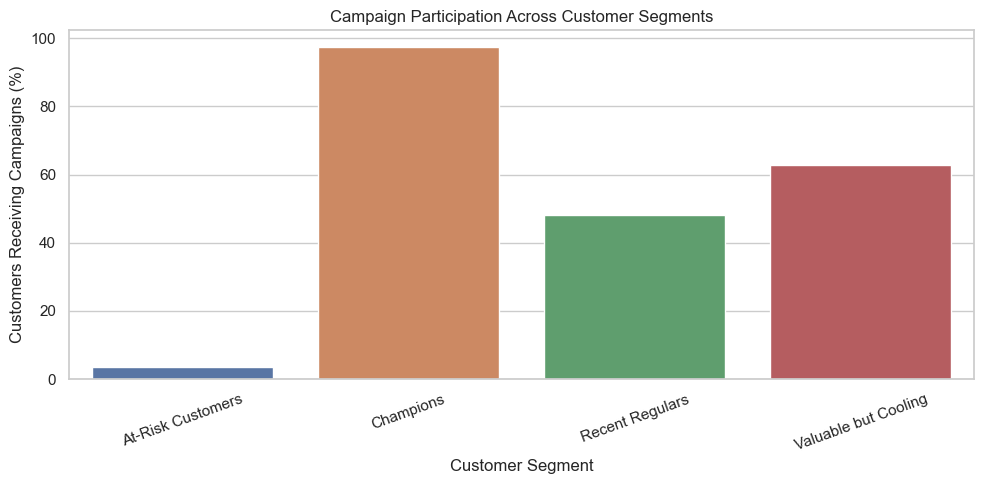
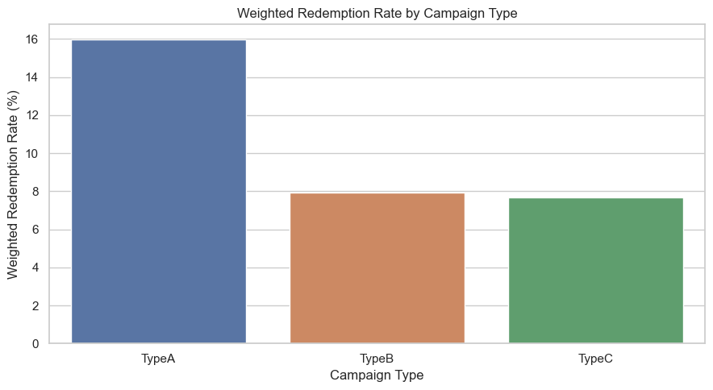

# E-commerce Customer Segmentation & Targeted Marketing Analytics

## Project Overview

This project applies customer analytics and machine learning techniques to identify distinct customer segments based on purchasing behaviour and develop targeted marketing strategies.

Using the **Dunnhumby – The Complete Journey** dataset, the analysis examines household-level transaction patterns, customer value, product-category preferences, brand purchasing behaviour, campaign participation and coupon redemption.

The project combines RFM analysis, K-means clustering, Principal Component Analysis (PCA), statistical hypothesis testing and logistic regression to generate actionable marketing insights.

> **Business objective:** Understand customer purchasing behaviour, identify valuable and at-risk customer groups, and recommend differentiated marketing strategies to improve customer engagement and retention.

## Dataset

**Source:** [Dunnhumby – The Complete Journey](https://www.dunnhumby.com/source-files/)

The dataset represents approximately 2,500 US grocery retail households over a two-year observation period.

| Dataset | Records | Description |
|---|---:|---|
| Transaction Data | 2,595,732 | Household purchase transactions |
| Product | 92,353 | Product and brand information |
| Household Demographics | 801 | Demographic information for a subset of households |
| Campaign Description | 30 | Campaign details and duration |
| Campaign Table | 7,208 | Household campaign assignments |
| Coupon | 124,548 | Coupon-to-product mapping |
| Coupon Redemption | 2,318 | Recorded coupon redemption events |
| Causal Data | 36,786,524 | Weekly product display and mailer information |

*Note: The demographic dataset covers only a subset of households. The Causal Data table is an optional supporting dataset and is not required to reproduce the core RFM segmentation.*

Raw dataset files are not included in this repository. Users should obtain the data from the original source and follow its applicable usage and redistribution terms.

## Methodology

### 1. Data Understanding and Preparation

- Inspected dataset dimensions, data types and missing values.
- Examined relationships between transaction, product, household and campaign tables.
- Investigated anomalous quantities, zero-value transactions and discount records.
- Created a separate analysis-ready transaction dataset.
- Aggregated transactions at the purchase-basket level.

### 2. RFM Analysis

Customer behaviour was measured using three metrics:

| Metric | Definition |
|---|---|
| Recency | Days since the household's most recent qualifying purchase |
| Frequency | Number of distinct purchase occasions |
| Monetary | Total customer spending across qualifying purchase occasions |

The monetary measure was calculated using the project's documented transaction treatment:

`CUSTOMER_SPEND = SALES_VALUE + COUPON_DISC`

Customer-level RFM metrics were calculated for all 2,500 households.

### 3. Feature Transformation and Scaling

- Applied logarithmic transformation using `log1p()` to reduce right-skewness.
- Standardised RFM features using `StandardScaler`.
- Retained the original RFM values for business interpretation.

### 4. Customer Segmentation Using K-Means

The optimal cluster count was explored using:

- Elbow Method
- Silhouette Score
- Cluster size distribution
- Customer-level RFM profiles

K = 2 achieved the highest Silhouette Score (0.4305), while K = 4 achieved 0.3286.

Four clusters were selected as the primary business segmentation because they offered more differentiated and actionable customer profiles. K = 2 was retained as a statistical benchmark.

### 5. Principal Component Analysis

PCA was applied to the standardised RFM variables to visualise the customer segments in two dimensions.

- PC1 explained 77.46% of the variance.
- PC2 explained 17.81%.
- Combined explained variance was 95.27%.

PCA was used for dimensionality reduction and visualisation; the final customer clusters were generated using the original standardised RFM features.

### 6. Customer Profiling and Statistical Analysis

Customer segments were further analysed using:

- Department-level spending
- Department penetration
- Customer category breadth
- Equal-purchase-opportunity comparison
- National versus Private brand spending
- Kruskal-Wallis tests
- Pairwise Mann-Whitney U tests with Holm correction

### 7. Campaign and Coupon Effectiveness

The campaign analysis investigated:

- Campaign participation by customer segment
- Coupon redemption rates
- Campaign-level performance
- Campaign-type performance
- Campaign duration and redemption relationships
- Logistic regression with household-clustered standard errors

## Customer Segmentation Results

The final K-means model identified four customer segments.

| Customer Segment | Customers | Share | Median Recency | Median Frequency | Median Monetary |
|---|---:|---:|---:|---:|---:|
| Champions | 930 | 37.2% | 3 days | 164 | $5,153.96 |
| Valuable but Cooling | 569 | 22.8% | 23 days | 59 | $1,782.20 |
| Recent Regulars | 638 | 25.5% | 4 days | 56 | $1,407.44 |
| At-Risk Customers | 363 | 14.5% | 55 days | 15 | $312.50 |

### Segment Characteristics

**1. Champions**

Recently active customers with the highest purchase frequency and monetary value. They represent the most valuable customer group.

**2. Valuable but Cooling**

Historically valuable customers who demonstrate relatively high cumulative spending but have longer gaps since their latest purchase.

**3. Recent Regulars**

Recently active customers who purchase regularly but have lower purchase frequency and monetary value than Champions.

**4. At-Risk Customers**

Customers with relatively low purchase frequency, low monetary value and longer periods since their last qualifying purchase.

## Key Analytical Findings

### 1. Customer Purchasing Behaviour

- The average household completed approximately 110 qualifying purchase occasions.
- Median customer spending was approximately $2,149.
- All three RFM variables exhibited positive skewness before log transformation.

### 2. Product Department Analysis

- Grocery accounted for approximately 50–53% of spending across all four segments.
- Champions had a median department breadth of 16, compared with 8 for At-Risk customers.
- After standardising purchase opportunities to 10 baskets per eligible customer, category-breadth differences became substantially smaller.
- This suggests that purchase frequency explains part of the observed difference in department breadth.

### 3. Brand Preference Analysis

- National brands contributed approximately 71–75% of spending across customer segments.
- Champions had the highest median Private brand spending share at 27.69%.
- Differences in household-level Private brand spending share were statistically significant overall, although the effect size was small.

### 4. Campaign Participation

Campaign exposure was not evenly distributed across customer segments.

| Segment | Campaign Participation |
|---|---:|
| Champions | 97.42% |
| Valuable but Cooling | 62.92% |
| Recent Regulars | 48.12% |
| At-Risk Customers | 3.58% |

This indicates a considerable gap in recorded campaign coverage among At-Risk customers.

### 5. Coupon Redemption Analysis

Across 7,208 assigned household-campaign combinations, 889 had at least one matched coupon redemption.

The overall campaign redemption rate was 12.33%.

| Campaign Type | Exposed Combinations | Redeemed Combinations | Weighted Redemption Rate |
|---|---:|---:|---:|
| TypeA | 3,979 | 635 | 15.96% |
| TypeB | 2,655 | 210 | 7.91% |
| TypeC | 574 | 44 | 7.67% |

TypeA exhibited the highest observed redemption rate.

The logistic regression analysis also found higher redemption odds for TypeA compared with TypeB, including after controlling for campaign duration (adjusted odds ratio: 1.8989).

### 6. Campaign Duration

- Bivariate Spearman correlation between campaign duration and redemption rate was 0.258 (p = 0.169).
- In the extended logistic regression, duration showed a positive association with redemption (odds ratio: 1.0121, p = 0.0014).
- Adding duration improved the conventional likelihood fit of the model (likelihood-ratio p = 0.00964).

These campaign-level results are exploratory and do not establish causal effects.

## Visualizations

### Customer Segmentation











### Customer Behaviour



### Campaign Analytics





## Marketing Recommendations

| Customer Segment | Marketing Objective | Recommended Strategy |
|---|---|---|
| Champions | Retention and value expansion | VIP loyalty rewards, personalised offers, cross-selling and complementary product recommendations |
| Valuable but Cooling | Customer reactivation | Targeted win-back campaigns, personalised incentives and reminders based on previous purchases |
| Recent Regulars | Basket growth and engagement | Product bundles, cross-category promotions and personalised recommendations |
| At-Risk Customers | Customer recovery | Small-scale reactivation experiments, relevant incentives and investigation of disengagement reasons |

### Overall Marketing Strategy

Adopt differentiated customer engagement strategies rather than relying on uniform promotional campaigns.

Prioritise retention among Champions, reactivation of Valuable but Cooling customers, basket growth among Recent Regulars and cost-effective win-back experiments for At-Risk customers.

TypeA campaigns represent a promising area for further investigation, but campaign targeting should be evaluated through controlled experiments before expanding promotional expenditure.

## Tools and Technologies

- **Programming:** Python
- **Data Manipulation:** Pandas, NumPy
- **Visualisation:** Matplotlib, Seaborn
- **Machine Learning:** Scikit-learn
- **Statistical Analysis:** SciPy, Statsmodels
- **Development Environment:** Jupyter Notebook / JupyterLab
- **Business Application:** Customer Segmentation and Marketing Analytics

## Repository Structure

```text
ecommerce-customer-segmentation/
│
├── README.md
│
├── notebooks/
│   └── 01_data_understanding.ipynb
│
├── data/
│   └── README.md
│
├── images/
│   ├── rfm_distributions.png
│   ├── elbow_method.png
│   ├── silhouette_analysis.png
│   ├── pca_customer_segments.png
│   ├── pca_explained_variance.png
│   ├── customer_segment_profiles.png
│   ├── department_analysis.png
│   └── campaign_redemption.png
│
├── output/
│   └── customer_segments.csv
│
├── requirements.txt
│
└── .gitignore
```

## Installation and Execution

### 1. Clone the repository

```bash
git clone <your-github-repository-url>
```

### 2. Navigate to the project directory

```bash
cd ecommerce-customer-segmentation
```

### 3. Create a virtual environment (recommended)

```bash
python -m venv venv
```

Activate it on Windows:

```bash
venv\Scripts\activate
```

### 4. Install dependencies

```bash
pip install -r requirements.txt
```

### 5. Download and organise the dataset

Obtain The Complete Journey dataset from Dunnhumby and place the required CSV files inside the `data/` directory.

Refer to `data/README.md` for the expected filenames.

### 6. Launch JupyterLab

```bash
cd notebooks
jupyter lab
```

Open `01_data_understanding.ipynb` and execute the notebook cells in sequence.

## Limitations and Future Scope

### Limitations

1. The dataset represents US grocery retail households and should not be interpreted as representative of Indian e-commerce consumers.
2. Household demographic information is available for only 801 of the 2,500 households.
3. The K = 4 segmentation provides greater business differentiation, although K = 2 achieved a higher Silhouette Score.
4. Campaign exposure was highly unequal across customer segments.
5. Coupon redemption does not necessarily represent incremental revenue or profit.
6. Campaign comparisons are observational and cannot establish causal campaign impact.
7. Campaign-level regression results are based on only 30 distinct campaigns and should be interpreted cautiously.

### Future Scope

- Explore hierarchical clustering and alternative segmentation algorithms.
- Incorporate additional demographic and behavioural features.
- Develop predictive customer churn and purchase propensity models.
- Evaluate promotional effectiveness through controlled experiments.
- Measure incremental revenue and profitability from customer targeting.
- Develop an interactive Power BI dashboard for customer segmentation and marketing performance.

## Conclusion

This project demonstrates how transaction-level customer data can be transformed into actionable customer intelligence.

By combining RFM analysis, K-means clustering, PCA, statistical testing and campaign evaluation, the project identifies distinct customer groups and develops differentiated marketing strategies.

The analysis highlights the importance of understanding not only customer value, but also purchasing behaviour, product engagement and promotional response when designing customer-centric marketing initiatives.
